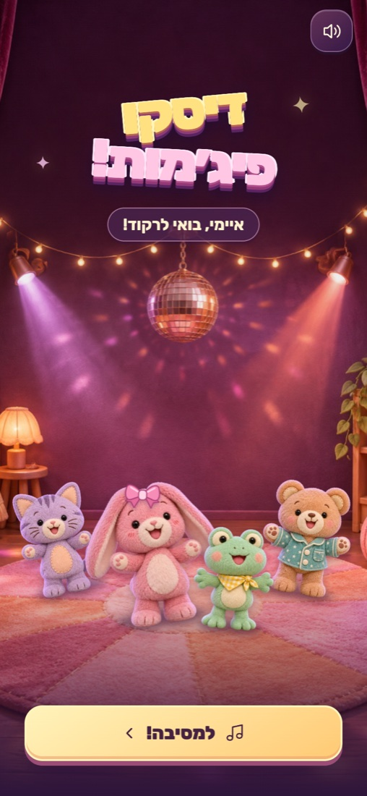
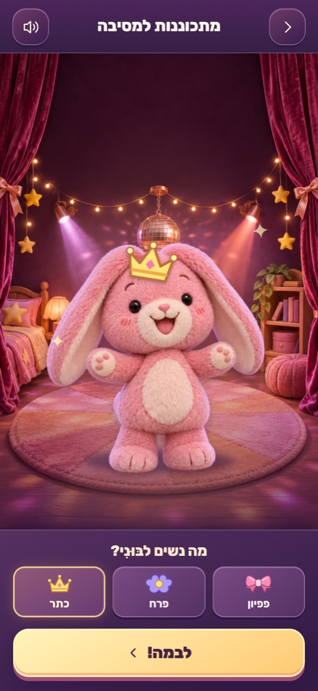
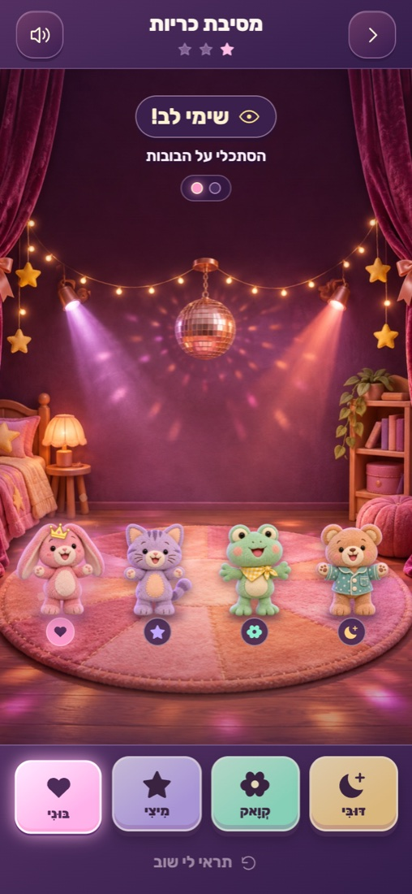
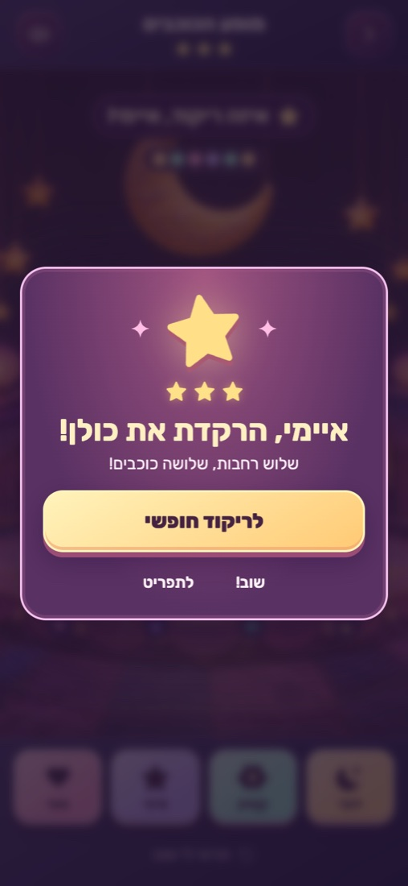
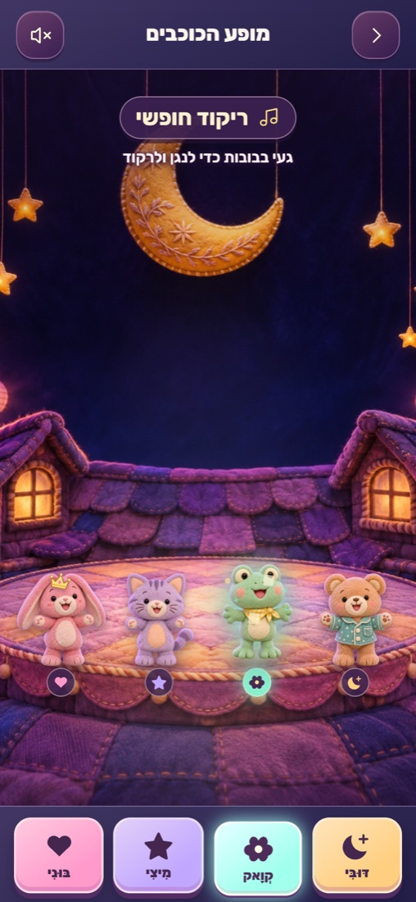

# דיסקו פיג׳מות

משחק מוזיקלי ונעים לטלפון, שנוצר עבור איימי. בוחרים אביזר לבובה, צופים ברצף ריקוד קצר, ומקישים על הבובות באותו סדר. מתקדמים בקצב אישי, ללא שעון או הגבלת ניסיונות.

**לשחק אונליין** — https://amitshe.github.io/pajama-disco/

## איך משחקים

1. לוחצים על **למסיבה!** ובוחרים לבּוּנִי פפיון, פרח או כתר.
2. לוחצים על **לבמה!** וצופים בבובות שמדגימות רצף.
3. כשהכיתוב **עכשיו תורך!** מופיע, נוגעים בבובות או בכפתורים שמתחתיהן לפי סדר ההדגמה.
4. אם מתבלבלים, הרצף מוצג שוב. אחרי שני ניסיונות מוצג גם רמז מואר. אפשר ללחוץ על **תראי לי שוב** בכל שלב.
5. משלימים שלושה ריקודים בכל אחת משלוש הרחבות. אחרי כולן נפתח **ריקוד חופשי**.

המוזיקה והצלילים נוצרים בדפדפן באמצעות Web Audio. האביזר הנבחר, הרחבות שהושלמו והעדפת הצליל נשמרים בדפדפן המקומי.

## צילומי מסך

<p align="center">
  
  
  
  
  
</p>

## הפעלה מקומית

אין שלב בנייה או התקנת חבילות. מריצים שרת HTTP מתוך תיקיית הפרויקט:

```sh
python3 -m http.server 8000
```

פותחים את http://localhost:8000/ בדפדפן.

## מבנה הפרויקט

- `index.html` מגדיר את מסכי הבית, בחירת האביזר, הריקוד והפרס.
- `styles.css` מכיל את העיצוב והתאמת המסכים לטלפון.
- `game.js` מכיל את הבובות, הרחבות, רצפי התנועות וכללי הניסיון החוזר.
- `music.js` יוצר את הצלילים והמוזיקה.
- `app.js` מפעיל את רצף המשחק, האנימציות, שליטת המגע והשמירה המקומית.
- `assets/` מכילה את הרקעים, הבובות, הסמל והגופנים. רישיון הגופן נמצא ב־`assets/rubik-license.txt`.

## פרסום

האתר סטטי ומתאים ל־GitHub Pages מתוך שורש ענף `main`. הקובץ `.nojekyll` מאפשר הגשה ישירה של הקבצים. שינוי שנדחף ל־`main` מתפרסם מחדש דרך Pages.
